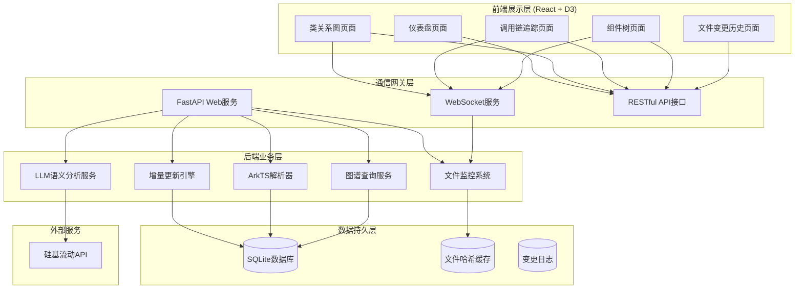
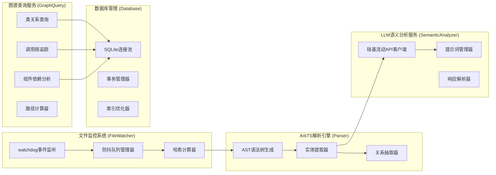
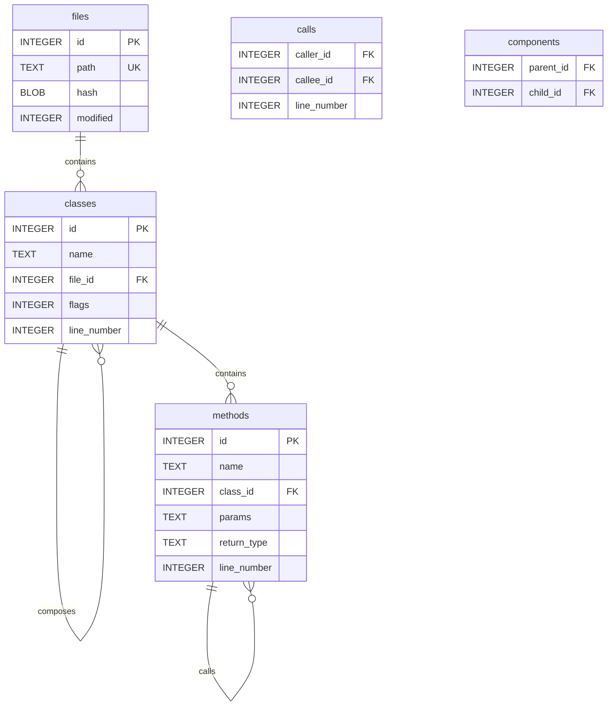
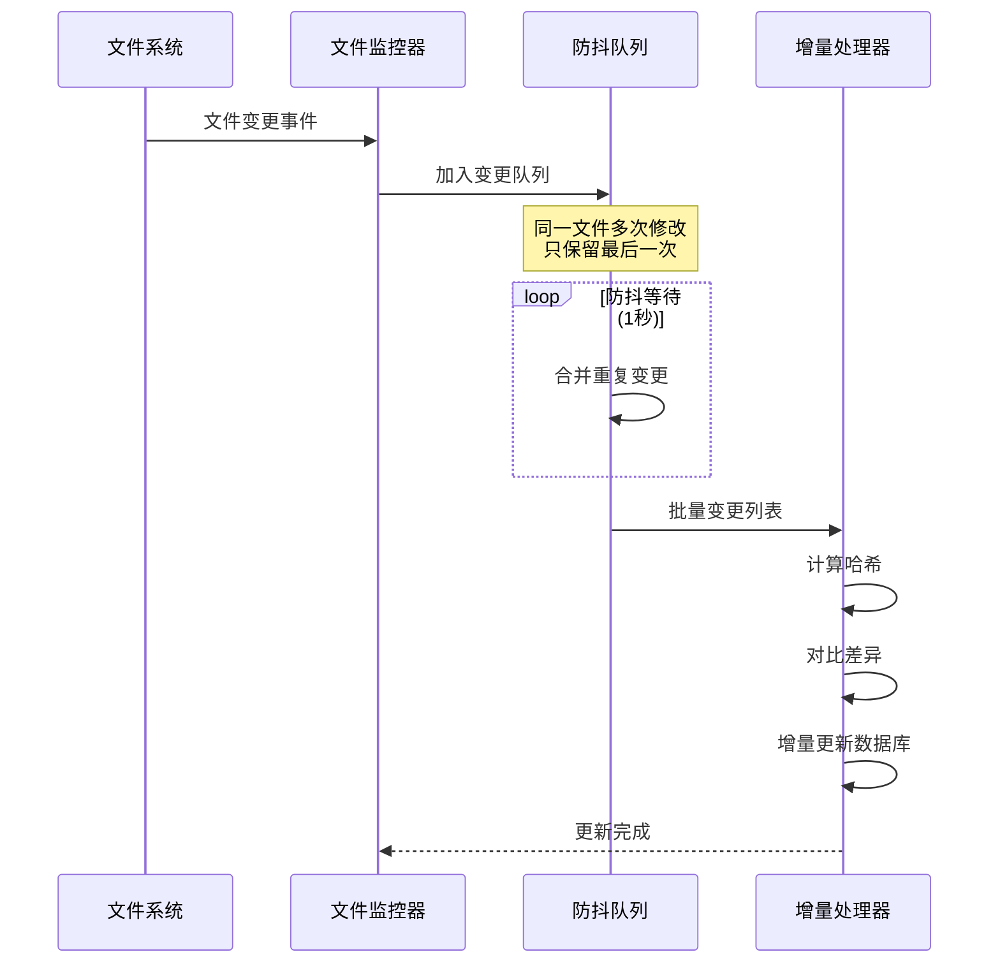
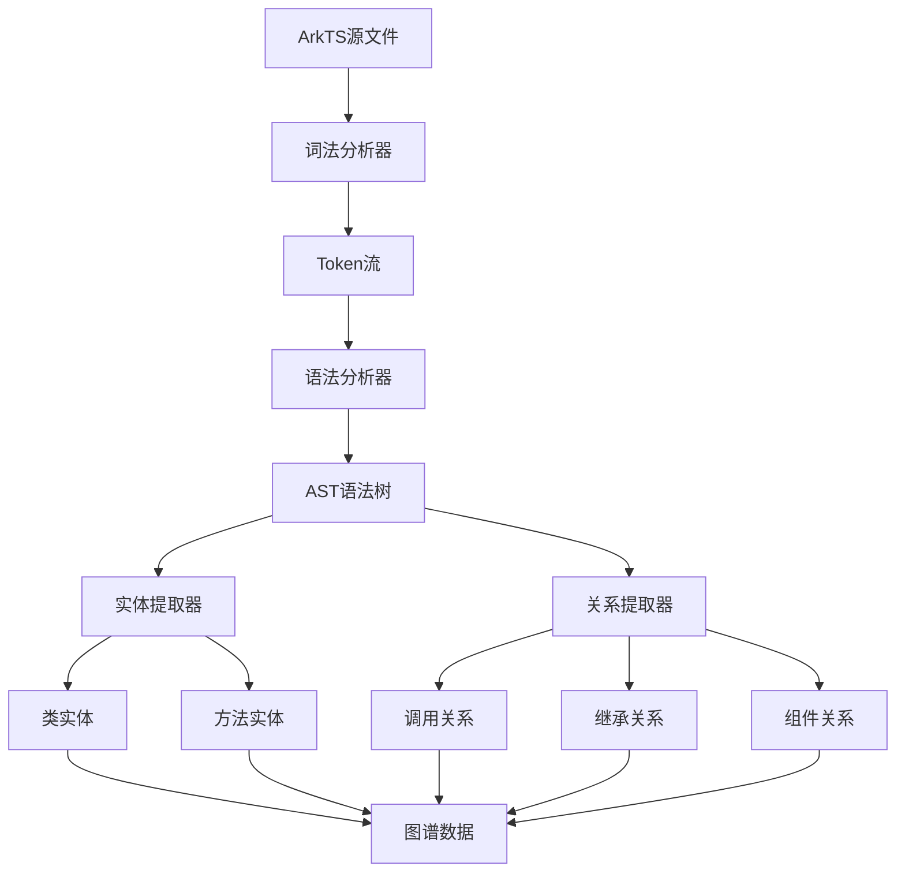
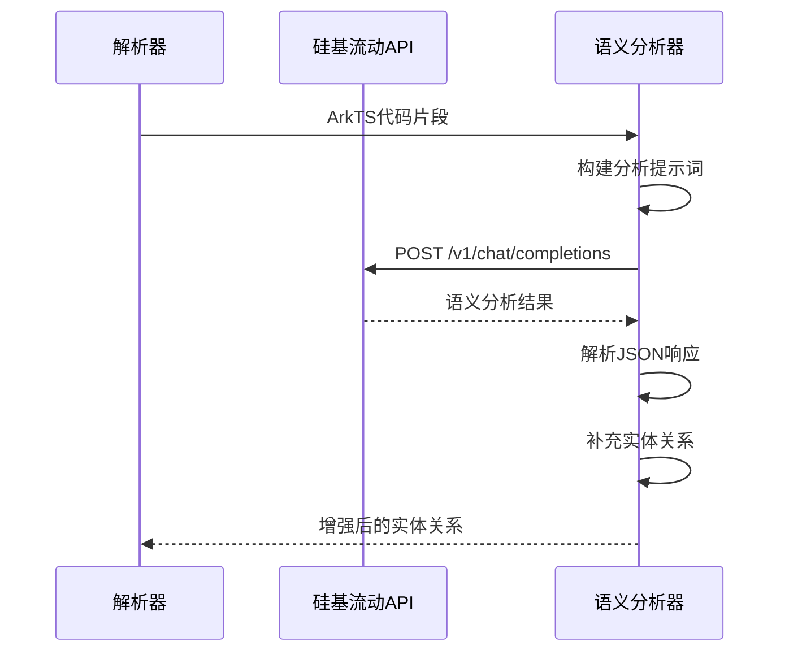
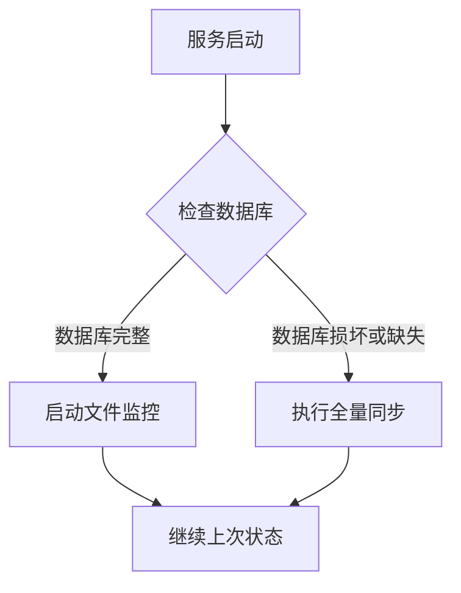

# ArkTS知识图谱动态更新系统 - 技术架构文档

## 1. 系统架构设计

### 1.1 整体架构图



### 1.2 模块职责划分



## 2. 技术栈详解

### 2.1 后端技术栈

| 组件 | 技术选型 | 版本要求 | 用途说明 |
|-----|---------|---------|---------|
| 运行环境 | Python | 3.10+ | 核心开发语言 |
| Web框架 | FastAPI | 0.104+ | 高性能异步API服务 |
| 异步运行时 | Uvicorn | 0.24+ | ASGI服务器 |
| 文件监控 | watchdog | 3.0+ | 跨平台文件系统监控 |
| 数据库 | SQLite | 3.x | 嵌入式图数据库 |
| 数据库ORM | SQLAlchemy | 2.0+ | 数据库抽象层 |
| HTTP客户端 | httpx | 0.25+ | 异步HTTP请求 |
| WebSocket | fastapi.websockets | 内置 | 实时通信 |
| 配置管理 | pydantic | 2.0+ | 配置验证 |

### 2.2 前端技术栈

| 组件 | 技术选型 | 版本要求 | 用途说明 |
|-----|---------|---------|---------|
| 框架 | React | 18.2+ | UI组件化框架 |
| 构建工具 | Vite | 5.0+ | 快速开发构建 |
| 语言 | TypeScript | 5.0+ | 类型安全 |
| 路由 | React Router | 6.0+ | 单页应用路由 |
| 状态管理 | Zustand | 4.0+ | 轻量状态管理 |
| 图表库 | D3.js | 7.0+ | 数据可视化 |
| 力导向图 | react-force-graph | 2.0+ | 知识图谱展示 |
| 样式 | Tailwind CSS | 3.0+ | 原子化CSS |
| UI组件 | Headless UI | 1.0+ | 无样式组件库 |
| 图标 | Lucide React | 最新 | 图标系统 |
| 动画 | Framer Motion | 10.0+ | 交互动画 |

### 2.3 外部服务集成

| 服务 | 提供商 | 用途 | 认证方式 |
|-----|--------|------|---------|
| LLM推理 | 硅基流动 | ArkTS代码语义分析 | API Key |

## 3. API接口定义

### 3.1 RESTful API

#### 3.1.1 项目概览接口

```
GET /api/v1/stats
```

**响应示例**:
```json
{
  "total_classes": 1234,
  "total_methods": 5678,
  "total_calls": 12345,
  "total_components": 456,
  "total_files": 789,
  "last_sync_time": "2024-01-15T10:30:00Z",
  "sync_status": "idle"
}
```

#### 3.1.2 类列表接口

```
GET /api/v1/classes?page=1&limit=50&search=User
```

**响应示例**:
```json
{
  "items": [
    {
      "id": 1,
      "name": "UserService",
      "file_path": "src/service/UserService.ets",
      "method_count": 15,
      "flags": 8,
      "created_at": "2024-01-15T10:30:00Z"
    }
  ],
  "total": 234,
  "page": 1,
  "limit": 50
}
```

#### 3.1.3 类详情接口

```
GET /api/v1/classes/{class_id}
```

**响应示例**:
```json
{
  "id": 1,
  "name": "UserService",
  "file_path": "src/service/UserService.ets",
  "methods": [
    {
      "id": 10,
      "name": "login",
      "params": "account: string, password: string",
      "return_type": "Promise<User>"
    }
  ],
  "relations": {
    "extends": [5],
    "implements": [],
    "calls": [20, 21, 22],
    "called_by": [30, 31]
  }
}
```

#### 3.1.4 调用链追踪接口

```
GET /api/v1/call-chain?from=10&to=50&max_depth=10
```

**响应示例**:
```json
{
  "paths": [
    {
      "nodes": [10, 20, 30, 50],
      "edges": [
        {"from": 10, "to": 20},
        {"from": 20, "to": 30},
        {"from": 30, "to": 50}
      ]
    }
  ],
  "total_paths": 3,
  "depth": 4
}
```

#### 3.1.5 组件列表接口

```
GET /api/v1/components
```

**响应示例**:
```json
{
  "items": [
    {
      "id": 100,
      "name": "UserCard",
      "file_path": "src/components/UserCard.ets",
      "parent_id": 101,
      "child_ids": [102, 103]
    }
  ]
}
```

#### 3.1.6 变更历史接口

```
GET /api/v1/changes?limit=20
```

**响应示例**:
```json
{
  "items": [
    {
      "file_path": "src/pages/Main.ets",
      "change_type": "modified",
      "timestamp": "2024-01-15T10:35:00Z",
      "entities_affected": 5,
      "update_duration_ms": 234
    }
  ]
}
```

#### 3.1.7 搜索接口

```
GET /api/v1/search?q=login&type=method
```

**响应示例**:
```json
{
  "results": [
    {
      "type": "method",
      "id": 10,
      "name": "login",
      "class_name": "UserService",
      "file_path": "src/service/UserService.ets"
    }
  ]
}
```

#### 3.1.8 配置更新接口

```
PUT /api/v1/config
```

**请求体**:
```json
{
  "watch_path": "/workspace/project",
  "api_key": "sk-xxx",
  "debounce_ms": 1000,
  "auto_sync": true
}
```

### 3.2 WebSocket接口

#### 3.2.1 实时更新通道

```
WS /ws/updates
```

**服务端推送消息格式**:

```json
{
  "type": "file_changed",
  "data": {
    "file_path": "src/pages/Main.ets",
    "change_type": "modified",
    "timestamp": "2024-01-15T10:35:00Z",
    "entities_affected": 5
  }
}
```

```json
{
  "type": "sync_complete",
  "data": {
    "total_files": 100,
    "duration_ms": 5000
  }
}
```

```json
{
  "type": "error",
  "data": {
    "message": "解析失败",
    "file_path": "src/broken.ets"
  }
}
```

## 4. 数据模型

### 4.1 实体关系图



### 4.2 数据库DDL

```sql
-- 文件表：存储被分析的文件
CREATE TABLE files (
    id INTEGER PRIMARY KEY AUTOINCREMENT,
    path TEXT UNIQUE NOT NULL,
    hash BLOB NOT NULL,
    modified INTEGER NOT NULL,
    created_at TIMESTAMP DEFAULT CURRENT_TIMESTAMP,
    updated_at TIMESTAMP DEFAULT CURRENT_TIMESTAMP
);

CREATE INDEX idx_files_path ON files(path);
CREATE INDEX idx_files_hash ON files(hash);

-- 类表：存储ArkTS类定义
CREATE TABLE classes (
    id INTEGER PRIMARY KEY AUTOINCREMENT,
    name TEXT NOT NULL,
    file_id INTEGER NOT NULL,
    flags INTEGER DEFAULT 0,
    line_number INTEGER,
    created_at TIMESTAMP DEFAULT CURRENT_TIMESTAMP,
    FOREIGN KEY (file_id) REFERENCES files(id) ON DELETE CASCADE
);

CREATE INDEX idx_classes_file ON classes(file_id);
CREATE INDEX idx_classes_name ON classes(name);

-- 方法表：存储类方法
CREATE TABLE methods (
    id INTEGER PRIMARY KEY AUTOINCREMENT,
    name TEXT NOT NULL,
    class_id INTEGER NOT NULL,
    params TEXT,
    return_type TEXT,
    line_number INTEGER,
    created_at TIMESTAMP DEFAULT CURRENT_TIMESTAMP,
    FOREIGN KEY (class_id) REFERENCES classes(id) ON DELETE CASCADE
);

CREATE INDEX idx_methods_class ON methods(class_id);
CREATE INDEX idx_methods_name ON methods(name);

-- 调用关系表：存储方法间调用
CREATE TABLE calls (
    caller_id INTEGER NOT NULL,
    callee_id INTEGER NOT NULL,
    line_number INTEGER,
    created_at TIMESTAMP DEFAULT CURRENT_TIMESTAMP,
    PRIMARY KEY (caller_id, callee_id),
    FOREIGN KEY (caller_id) REFERENCES methods(id) ON DELETE CASCADE,
    FOREIGN KEY (callee_id) REFERENCES methods(id) ON DELETE CASCADE
);

CREATE INDEX idx_calls_caller ON calls(caller_id);
CREATE INDEX idx_calls_callee ON calls(callee_id);

-- 组件关系表：存储@Component装饰器关系
CREATE TABLE components (
    parent_id INTEGER NOT NULL,
    child_id INTEGER NOT NULL,
    PRIMARY KEY (parent_id, child_id),
    FOREIGN KEY (parent_id) REFERENCES classes(id) ON DELETE CASCADE,
    FOREIGN KEY (child_id) REFERENCES classes(id) ON DELETE CASCADE
);

CREATE INDEX idx_components_parent ON components(parent_id);
CREATE INDEX idx_components_child ON components(child_id);

-- 变更日志表：记录文件变更历史
CREATE TABLE change_logs (
    id INTEGER PRIMARY KEY AUTOINCREMENT,
    file_path TEXT NOT NULL,
    change_type TEXT NOT NULL,
    file_hash_before BLOB,
    file_hash_after BLOB,
    entities_count INTEGER,
    duration_ms INTEGER,
    created_at TIMESTAMP DEFAULT CURRENT_TIMESTAMP
);

CREATE INDEX idx_change_logs_time ON change_logs(created_at DESC);

-- 配置表：存储系统配置
CREATE TABLE config (
    key TEXT PRIMARY KEY,
    value TEXT NOT NULL,
    updated_at TIMESTAMP DEFAULT CURRENT_TIMESTAMP
);
```

## 5. 核心模块详细设计

### 5.1 文件监控系统



### 5.2 ArkTS解析器设计



### 5.3 LLM语义分析流程



## 6. 目录结构

```
ark-analyzer/
├── backend/
│   ├── src/
│   │   ├── __init__.py
│   │   ├── main.py                 # FastAPI应用入口
│   │   ├── config.py               # 配置管理
│   │   ├── database/
│   │   │   ├── __init__.py
│   │   │   ├── connection.py       # SQLite连接管理
│   │   │   ├── models.py           # SQLAlchemy模型
│   │   │   └── repository.py       # 数据访问层
│   │   ├── services/
│   │   │   ├── __init__.py
│   │   │   ├── file_watcher.py      # 文件监控系统
│   │   │   ├── parser.py            # ArkTS解析器
│   │   │   ├── semantic_analyzer.py # LLM语义分析
│   │   │   ├── graph_query.py       # 图谱查询服务
│   │   │   └── sync_engine.py       # 同步引擎
│   │   ├── api/
│   │   │   ├── __init__.py
│   │   │   ├── routes.py            # API路由
│   │   │   └── websocket.py         # WebSocket处理
│   │   └── utils/
│   │       ├── __init__.py
│   │       └── hash_util.py         # 哈希工具
│   ├── requirements.txt
│   └── pyproject.toml
├── frontend/
│   ├── src/
│   │   ├── main.tsx
│   │   ├── App.tsx
│   │   ├── components/
│   │   │   ├── Dashboard/
│   │   │   ├── GraphView/
│   │   │   ├── CallChain/
│   │   │   ├── ComponentTree/
│   │   │   ├── ChangeHistory/
│   │   │   └── Layout/
│   │   ├── pages/
│   │   ├── hooks/
│   │   ├── stores/
│   │   ├── services/
│   │   ├── types/
│   │   └── styles/
│   ├── public/
│   ├── index.html
│   ├── package.json
│   ├── tsconfig.json
│   ├── vite.config.ts
│   └── tailwind.config.js
├── sample-project/                  # 示例ArkTS项目
│   ├── src/
│   │   ├── pages/
│   │   ├── components/
│   │   └── services/
│   └── entry.ets
├── docs/
│   ├── api.md
│   └── architecture.md
└── README.md
```

## 7. 性能优化策略

### 7.1 数据库优化

- **索引优化**: 为高频查询字段创建复合索引
- **批量操作**: 使用INSERT...ON CONFLICT批量更新
- **连接池**: 复用数据库连接
- **事务合并**: 多个小操作合并为单个大事务

### 7.2 解析优化

- **增量解析**: 只解析变更文件
- **缓存复用**: 相同代码片段复用解析结果
- **并行处理**: 多文件并行解析

### 7.3 前端优化

- **虚拟列表**: 大数据量时使用虚拟滚动
- **懒加载**: 图谱按需加载节点
- **WebWorker**: 复杂计算移至Worker线程
- **骨骼屏**: 加载时显示骨架占位

## 8. 错误处理机制

### 8.1 错误分类

| 错误类型 | 处理策略 | 影响范围 |
|---------|---------|---------|
| 文件读取失败 | 记录日志，跳过该文件 | 单文件 |
| 解析语法错误 | 记录错误，保留旧数据 | 单文件 |
| LLM API超时 | 重试3次，失败则跳过语义增强 | 单文件 |
| 数据库写入失败 | 回滚事务，告警通知 | 整个批次 |
| WebSocket断开 | 自动重连，前端缓存 | 无持久影响 |

### 8.2 崩溃恢复



## 9. 安全考虑

- **API Key存储**: 使用环境变量，不硬编码
- **路径遍历防护**: 验证文件路径在监控目录下
- **SQL注入防护**: 使用参数化查询
- **CORS配置**: 限制前端域名访问
- **输入验证**: 使用Pydantic验证所有输入
