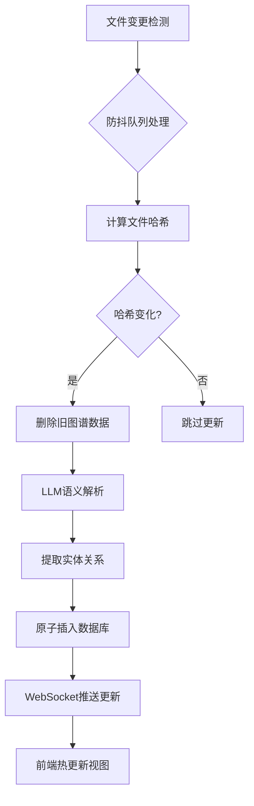
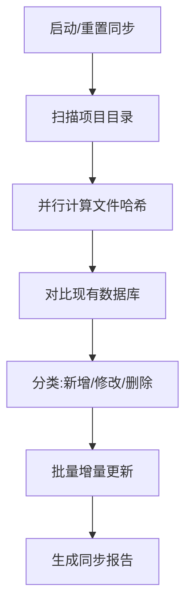

# ArkTS知识图谱动态更新系统 - 产品需求文档

## 1. 产品概述

**项目名称**: ArkAnalyzer动态可视化系统

**一句话定位**: 面向百万行级ArkTS代码的实时知识图谱构建与可视化平台

**核心价值**:
- 基于第一性原理设计的增量更新机制，实现代码修改后<2秒的响应延迟
- 将静态代码分析升级为持续演进的知识网络
- 为开发者提供代码结构、调用关系、组件依赖的实时可视化洞察

**目标用户**: ArkTS/HarmonyOS应用开发者、大型前端团队、技术架构师

## 2. 核心功能

### 2.1 用户角色

| 角色 | 使用场景 | 核心需求 |
|------|---------|---------|
| 开发者 | 日常编码过程中 | 实时了解代码结构、追踪调用链、理解组件关系 |
| 代码审查者 | Code Review阶段 | 快速定位变更影响范围、发现循环依赖 |
| 架构师 | 系统设计阶段 | 宏观视图下理解代码组织、识别架构问题 |

### 2.2 功能模块

#### 2.2.1 知识图谱可视化模块

**类关系图**:
- 展示所有类的继承、实现、组合关系
- 支持缩放、平移、筛选
- 悬停显示类的详细信息（方法数、属性、注释）

**调用关系图**:
- 函数/方法间的调用拓扑
- 高亮显示关键路径
- 循环依赖检测与警示

**组件依赖树**:
- @Component装饰器的组件层级
- 父子组件关系可视化
- Props传递链路追踪

#### 2.2.2 文件变更监控模块

**实时监控面板**:
- 显示最近变更的文件列表
- 每个文件的变更类型标签（新增/修改/删除）
- 变更时间戳和影响范围预估

**增量更新状态**:
- 图谱更新进度指示器
- 每个文件的解析耗时
- 错误告警与重试机制

#### 2.2.3 架构分析模块

**项目结构总览**:
- 目录树形图与文件统计
- 模块划分建议
- 入口文件识别

**代码质量指标**:
- 类大小分布（方法数量、代码行数）
- 复杂度过高预警
- 重复代码检测

#### 2.2.4 查询探索模块

**智能搜索**:
- 类名、方法名、变量名模糊搜索
- 搜索结果高亮与跳转
- 历史搜索记录

**关系追踪**:
- 起点→终点的完整调用链
- 某方法的所有调用者/被调用者
- 某组件的所有引用位置

### 2.3 页面详情

| 页面名称 | 核心模块 | 功能描述 |
|---------|---------|---------|
| 仪表盘首页 | 项目概览卡片、最近变更列表、实时状态指示器 | 展示整体健康状态和关键指标 |
| 类关系图页面 | 可交互D3力导向图、筛选面板、详情侧边栏 | 探索类之间的复杂关系网络 |
| 调用链追踪页面 | 调用栈可视化、路径高亮、过滤器 | 追踪函数的调用链路 |
| 组件树页面 | 树形层级图、组件卡片、属性面板 | 展示UI组件的组成结构 |
| 文件变更历史 | 时间线视图、diff预览、影响分析 | 追踪文件变更与图谱更新 |
| 设置页面 | 监控路径配置、API配置、刷新策略 | 系统参数管理 |

## 3. 核心流程

### 3.1 增量更新流程



### 3.2 知识图谱查询流程


### 3.3 全量同步流程



## 4. 用户界面设计

### 4.1 设计风格

**视觉主题**: 深色科技风 + 霓虹点缀（代码/数据的隐喻）

**色彩体系**:
- 主色: `#1a1a2e` (深邃夜空)
- 次色: `#16213e` (科技蓝)
- 强调色: `#0f3460` (活力蓝)
- 点缀色: `#e94560` (警示红), `#00ff88` (成功绿)
- 文字色: `#eaeaea` (主文字), `#7f8c8d` (次文字)

**字体选择**:
- 标题: JetBrains Mono (等宽、现代)
- 正文: Noto Sans SC (中文友好)
- 代码: Fira Code (连字支持)

**布局风格**:
- 左侧导航 + 右侧内容区
- 卡片式信息展示
- 响应式: 桌面优先，支持平板

**动效设计**:
- 图谱节点弹跳入场
- 页面切换滑入效果
- 数据更新闪烁高亮
- 加载状态骨架屏

### 4.2 页面设计

#### 仪表盘首页

```
┌─────────────────────────────────────────────────────────┐
│  [Logo] ArkAnalyzer          [状态指示] [设置] [帮助]   │
├────────┬────────────────────────────────────────────────┤
│        │ ┌─────────┐ ┌─────────┐ ┌─────────┐         │
│  📊 概览 │ │ 总类数  │ │ 总方法  │ │ 总调用  │         │
│  🔗 类图 │ │  1,234  │ │  5,678  │ │ 12,345  │         │
│  📞 调用 │ └─────────┘ └─────────┘ └─────────┘         │
│  🧩 组件 │ ┌────────────────────────────────────────┐   │
│  📁 文件 │ │ 实时变更监控                            │   │
│  ⚙️ 设置 │ │ ● MainPage.ets  刚刚修改               │   │
│        │ │ ● Login.ets      5分钟前                 │   │
│        │ └────────────────────────────────────────┘   │
└────────┴────────────────────────────────────────────────┘
```

#### 类关系图页面

```
┌─────────────────────────────────────────────────────────┐
│ 类关系图                    [筛选▼] [搜索...] [刷新]    │
├────────┬────────────────────────────────────────────────┤
│        │                                                 │
│ 类列表 │          ○ UserService                          │
│ ├─Auth │            │                                     │
│ │ ├─Lo │            │ extends                             │
│ │ └─Re │            ▼                                     │
│ └─Data │          ● BaseService ───→ ● ApiClient         │
│        │            │                                     │
│        │         implements                               │
│        │            ▼                                     │
│        │          ○ Repository                           │
│        │                                                 │
└────────┴────────────────────────────────────────────────┘
```

### 4.3 响应式设计

- **桌面 (>1200px)**: 左侧导航 + 主内容区 + 可选侧边栏
- **平板 (768-1200px)**: 折叠导航 + 全宽内容
- **手机 (<768px)**: 底部Tab导航 + 卡片式布局

## 5. 非功能需求

### 5.1 性能指标

| 指标 | 目标值 | 说明 |
|-----|--------|-----|
| 单文件更新延迟 | <500ms | 最常见场景 |
| 10文件批量更新 | <2s | 分支切换场景 |
| 100文件批量更新 | <10s | 代码拉取场景 |
| 全量同步(100万行) | <8分钟 | 首次运行 |
| 查询响应时间 | <100ms | 简单查询 |
| 前端渲染帧率 | >30fps | 复杂图谱交互 |

### 5.2 可用性

- 后台静默运行，不干扰开发
- 前端更新无刷新，用户无感知
- 错误自动重试，日志完整记录
- 崩溃恢复机制：下次启动自动全量同步

### 5.3 资源占用

- CPU: <5% (后台监控)
- 内存: <100MB (后台服务)
- 磁盘: SQLite数据库 (~10MB/10万行代码)

## 6. 技术选型理由

| 组件 | 选型 | 理由 |
|-----|------|------|
| 后端语言 | Python 3.10+ | 生态丰富、语法简洁、文本处理强 |
| Web框架 | FastAPI | 异步高性能、自动文档、类型安全 |
| 数据库 | SQLite | 零配置、嵌入式、图查询高效 |
| 前端框架 | React 18 | 组件化、生态成熟、虚拟DOM |
| 可视化库 | D3.js + React Force Graph | 灵活、定制强、适合知识图谱 |
| 文件监控 | watchdog | 跨平台、事件丰富、稳定 |
| LLM调用 | 硅基流动API | 免费、速度快、中文理解好 |
| 实时通信 | WebSocket | 实时推送、低延迟、简单 |
